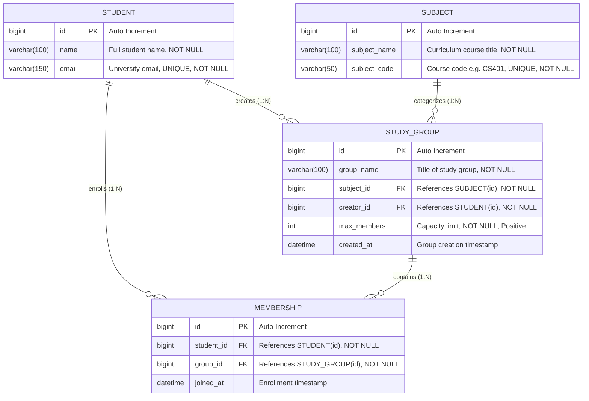

# StudyBuddy – Entity Relationship (ER) Diagram

## 1. System Overview
The StudyBuddy system models the collaborative relationship between college students, subjects in their academic curriculum, study groups formed around specific subjects, and student group memberships.

---

## 2. Mermaid ER Diagram

---

## 3. Relational Schema & Constraints

### 3.1 `students` Table
| Column | Data Type | Modifiers / Constraints | Description |
|---|---|---|---|
| `id` | `BIGINT` | PRIMARY KEY, AUTO_INCREMENT | Unique identifier for student |
| `name` | `VARCHAR(100)` | NOT NULL | Full name of the student |
| `email` | `VARCHAR(150)` | NOT NULL, UNIQUE (`uk_students_email`) | Student university email |

### 3.2 `subjects` Table
| Column | Data Type | Modifiers / Constraints | Description |
|---|---|---|---|
| `id` | `BIGINT` | PRIMARY KEY, AUTO_INCREMENT | Unique identifier for subject |
| `subject_name` | `VARCHAR(100)` | NOT NULL | Title of academic subject |
| `subject_code` | `VARCHAR(50)` | NOT NULL, UNIQUE (`uk_subjects_code`) | Unique departmental course code |

### 3.3 `study_groups` Table
| Column | Data Type | Modifiers / Constraints | Description |
|---|---|---|---|
| `id` | `BIGINT` | PRIMARY KEY, AUTO_INCREMENT | Unique group identifier |
| `group_name` | `VARCHAR(100)` | NOT NULL | Title of the study group |
| `subject_id` | `BIGINT` | NOT NULL, FK -> `subjects(id)` | Associated course subject |
| `creator_id` | `BIGINT` | NOT NULL, FK -> `students(id)` | Designated founder & moderator |
| `max_members`| `INT` | NOT NULL, CHECK (`max_members > 0`) | Configurable maximum student capacity |
| `created_at` | `DATETIME` | NOT NULL, DEFAULT `CURRENT_TIMESTAMP` | Timestamp of creation |

### 3.4 `memberships` Table
| Column | Data Type | Modifiers / Constraints | Description |
|---|---|---|---|
| `id` | `BIGINT` | PRIMARY KEY, AUTO_INCREMENT | Unique membership enrollment ID |
| `student_id` | `BIGINT` | NOT NULL, FK -> `students(id)` | Enrolled student |
| `group_id` | `BIGINT` | NOT NULL, FK -> `study_groups(id)` | Target study group |
| `joined_at` | `DATETIME` | NOT NULL, DEFAULT `CURRENT_TIMESTAMP` | Date and time joined |
| `uk_membership_student_group` | UNIQUE (`student_id`, `group_id`) | Ensures a student cannot join the same group twice |

---

## 4. Cardinality & Relationship Justification
1. **Subject to StudyGroup (1:N)**: A single subject (e.g. Operating Systems) can have multiple study circles catering to different time preferences or study goals. A group belongs to exactly one subject.
2. **Student to StudyGroup Creator (1:N)**: A student can found multiple study groups across subjects. Every group has exactly one creator.
3. **Student to Membership (1:N)**: A student can join multiple study groups for different topics.
4. **StudyGroup to Membership (1:N)**: A group contains many members, bounded by `max_members`.
5. **Creator Auto-Enrollment**: When a study group is created, a corresponding membership record is automatically inserted for the creator, establishing them as member #1.
