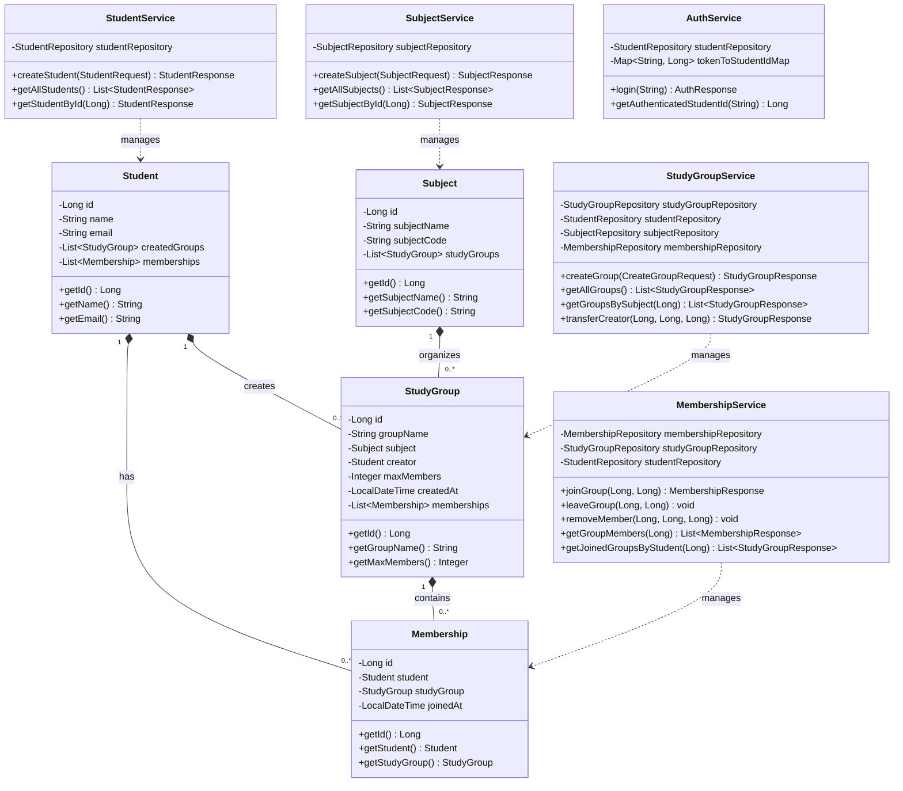

# StudyBuddy – UML Class Diagram & Software Architecture

## 1. Architectural Pattern: 4-Tier Layered Architecture
StudyBuddy is designed according to clean separation of concerns:
```
[React Vite Frontend]
         │ (HTTP / JSON / Axios with CORS)
         ▼
[REST Controller Layer]   --> Input Validation, HTTP Status Codes, DTO Mapping
         │
         ▼
[Service Layer]           --> Business Rules, Transactions (@Transactional), Pessimistic Locking
         │
         ▼
[Repository Layer]        --> Spring Data JPA / Hibernate ORM
         │
         ▼
[MySQL Database]          --> Relational Tables, Constraints, Indexes
```

---

## 2. Mermaid UML Class Diagram



---

## 3. Layer Breakdown

### 3.1 Entity Layer (`com.studybuddy.entity`)
- **`Student`**: Represents user accounts with uniqueness constraint on `email`.
- **`Subject`**: Academic subjects identified by unique `subjectCode`.
- **`StudyGroup`**: Groups created by a Student for a specific Subject with positive `maxMembers`.
- **`Membership`**: Relational junction table linking a Student to a StudyGroup, with composite uniqueness `(student_id, group_id)`.

### 3.2 Repository Layer (`com.studybuddy.repository`)
- **`StudentRepository`**: Spring Data JPA repository for students.
- **`SubjectRepository`**: JPA repository for subjects.
- **`StudyGroupRepository`**: Incorporates `@Lock(LockModeType.PESSIMISTIC_WRITE)` query (`findByIdWithPessimisticLock`) to acquire MySQL row-level exclusive locks during group join operations.
- **`MembershipRepository`**: Provides membership counting, existence checks, student lookup, and group member listings.

### 3.3 Service Layer (`com.studybuddy.service`)
- **`StudyGroupService`**: Enforces group creation logic, subject validation, positive capacity checks, and automatic creator enrollment.
- **`MembershipService`**: Enforces capacity caps (Rule 1), duplicate membership rejection (Rule 2), creator departure guards (Feature 3), and verified creator-only member removal (Feature 5).
- **`AuthService`**: Server-side verified session manager that binds cryptographically secure UUID tokens to authenticated students.

### 3.4 Controller Layer (`com.studybuddy.controller`)
- **`StudyGroupController`**: Exposes `/api/groups`, handling creation and subject-wise filtering.
- **`MembershipController`**: Exposes join, leave, list members, and creator-only removal endpoints.
- **`StudentController`**: Exposes student registration and joined group retrieval.
- **`SubjectController`**: Exposes subject listing and creation.
- **`AuthController`**: Exposes `/api/auth/login` and `/api/auth/me`.

### 3.5 Global Exception Handling (`com.studybuddy.exception`)
- **`GlobalExceptionHandler`**: `@RestControllerAdvice` converting domain exceptions (`GroupFullException`, `DuplicateResourceException`, `ResourceNotFoundException`, `ForbiddenException`, `UnauthorizedException`) into clean JSON payloads with appropriate HTTP status codes (201, 400, 401, 403, 404, 409).
